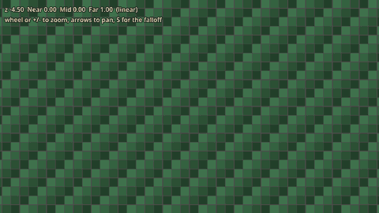

# Zoom Bands for Godot 4

Crossfade 2D detail layers by camera zoom. One continuous zoom axis, evenly spaced bands,
no popping between levels of detail and no zoom that shows nothing.



The plugin itself, with its full guide and API, is in
[`addons/zoom_bands/README.md`](addons/zoom_bands/README.md).

## Install

- From the Godot Asset Store: search for Zoom Bands there and download it.
  The download holds only `addons/zoom_bands/`.
- By hand: copy `addons/zoom_bands/` into your project's `addons/` folder. The classes register
  through `class_name`, so enabling the plugin in Project Settings is optional.

## Use

```gdscript
var bands := ZoomBandController.new()
bands.camera = $Camera2D
bands.bands = [
	ZoomBand.make(^"../Near", 0.0, ZoomBands.Hold.ABOVE),
	ZoomBand.make(^"../Mid", -2.0),
	ZoomBand.make(^"../Far", -4.0, ZoomBands.Hold.BELOW),
]
add_child(bands)
```

Or set it up in the editor: add a `ZoomBandController` node and turn on its editor preview to
see the crossfade without running the game. The node warns you when a band has no target or the
band width is too narrow for your centres.

Open this folder as a Godot project to run the demo (`addons/zoom_bands/demo/demo.tscn` is the
main scene). Mouse wheel or +/- zooms, arrow keys pan, S switches the falloff.

## Limits

- 2D only: it reads a `Camera2D`, or a zoom value you pass to `apply_zoom(z)`.
- It reads `camera.zoom.x`, so it assumes the same zoom on both axes.
- One `band_width` and one falloff (linear or smooth) for all bands of a controller.
- GDScript only. Godot 4.3 or later; tested on 4.3, 4.4, 4.5, 4.6 and 4.7.
- The tests in `addons/zoom_bands/tests/` need GUT 9.x. Delete that folder if you do not use GUT.

## Licence

Apache-2.0. See [`LICENSE`](LICENSE) and [`NOTICE`](NOTICE). Free for any game, commercial
included. Keep the NOTICE file (or its text) when you redistribute the plugin.

## Support

Bugs: open an issue on this repository with a minimal project that shows it. Issues are read
when time allows; no reply time is promised and no custom work is offered.

## AI disclosure

The code, demo scene, tests and documentation were written with Claude, Anthropic's AI model,
and checked by Revenantworks with the plugin's own test suite on Godot 4.3 to 4.7. No
AI-generated images, sound or fonts in the plugin: the demo draws plain shapes in code, and the
editor icons are plain shapes written by hand as SVG text. The store icon in
`media/` is a placeholder of plain shapes, drawn by a script written with Claude.

Made by Revenantworks.
